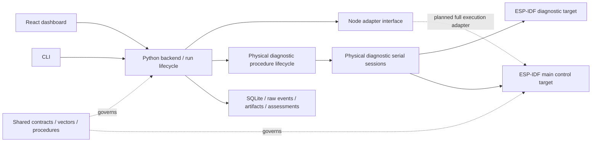

# Repository architecture

One repository keeps host and firmware changes reviewable against shared wire
contracts, test vectors, procedures and hardware decisions. It does not require
both toolchains for every task. The Python project remains self-contained under
`testbed/`; ESP-IDF targets remain independently buildable under `firmware/`.



Dotted full-execution integration is planned. Diagnostic firmware cannot execute
full RF/audio commands. The main node target provides the Milestone 1 board/control foundation in source:
strict serial control, identity/health, ownership, duplicate protection and a finite
memory operation. The new image still needs physical acceptance. Its capability-based build order
and completion gates are in [node development plan](node_development_plan.md);
module implementations are not organized by experiment IDs.

## Source placement

| Location | Owns | Does not own |
| --- | --- | --- |
| `testbed/src/lora_testbed` | Host orchestration, physical sessions, persistence, assessments, CLI and HTTP/event interface | Board driver implementation or browser-local run ownership |
| `testbed/frontend` | Operator controls and evidence visualization | Serial ports or independent passing criteria |
| `firmware/lora_node` | Main composition, platform/USB modules and portable control | Host experiment scheduling and analysis |
| `firmware/diagnostic` | Existing limited physical diagnostic image | Full RF/security/audio implementation |
| `firmware/components` | Future reusable board, serial, radio, packet, security, audio and run-control modules | Implemented functionality merely because a directory is documented |
| `contracts/v2` | Shared baseline defaults, generated schemas and public vectors | Measured capability claims |
| `hardware` | Board/wiring planning manifest, sources and diagram | Automatic hardware discovery or validated drivers |
| `docs` | Requirements, status, procedures, decisions and agent task context | A replacement for source-code evidence |
| `scripts` | Cross-project generation and verification | Duplicated host/firmware domain logic |

The host is physical-only. `nodes.py` provides the implemented diagnostic session
interface, used by the partial IF-01 check. A future full RF serial adapter must
satisfy the execution interface in `adapters.py` with compatibility and capability
checks before enabling runs or campaigns. No virtual devices or simulator runners
are instantiated or retained as operator features.

## Main firmware layout

`firmware/lora_node/main` has concrete modules for the current control foundation:

```text
main/
├── CMakeLists.txt
├── idf_component.yml
├── lora_node.c                 app_main composition
├── platform/
│   ├── esp32_platform.c        ESP-IDF identity, NVS, heap, timer and crypto callbacks
│   └── esp32_platform.h
├── transport/
│   ├── usb_transport.c         USB read/tick loop and the single protocol writer
│   └── usb_transport.h
├── control/
│   ├── node_control.c          Portable commands, ownership, queues and operation state
│   └── node_control.h
├── protocol/
│   ├── strict_json.c           Bounded UTF-8/JSON validation and integer-token checks
│   └── strict_json.h
└── generated/
    └── contract_schema.h       Root contract-generator output
```

The platform fills the existing `node_platform` interface; metadata strings remain
valid for the firmware lifetime. The USB module owns the hardware loop and calls
the portable control interface. The control module uses JSON validation, but neither
portable module imports ESP-IDF or FreeRTOS. Its internal ownership/queue/operation
state stays private, so callers and native tests use the same small interface.

CMake lists each compiled source explicitly, with `main/` as the include root;
qualified includes identify cross-directory dependencies. The generator and native
compiler fixture use these same paths. This is directory organization within one
ESP-IDF main component, not a collection of premature shared components. Radio,
audio and other future modules are added only when implementing real behavior.

## Important existing host modules

- `app.py` and `cli.py`: entry interfaces; use the same Host and procedure paths.
- `host.py`: bench ownership and lifecycle coordination.
- `adapters.py`: node interface, request/reply/event handling and failures.
- `nodes.py`: physical serial sessions for the exact diagnostic or main-control
  schema; operation results and health share the existing observation store.
- `control_v2.py`: separately generated main-control schema; the original
  diagnostic and full execution schema surfaces remain distinct.
- `catalog.py`: all 23 procedures, local/pair node requirements and capability blockers.
- `procedure_runs.py`, `serial_validation.py`: bounded physical diagnostic checks,
  cancellation, partial qualification scope and durable procedure evidence.
- `analysis_v2.py`, `run_records_v2.py`, `reports_v2.py`: analysis, durable records,
  comparisons and exports. Preserve execution outcome separately from assessment.
- `paths.py`: the source-checkout layout seam. Shared content resolves from the
  repository root; UI assets resolve from `testbed/frontend/dist`.

Do not add pass-through layers simply to match this document. When deepening a
module, keep its caller interface small and concentrate its rules and checks
behind that interface. Changes should reduce the knowledge required by callers.

## Contract ownership

There is one root `contracts/` directory and one root `docs/` procedure set.
Typed Python models currently define generated schemas; the root generator emits
those schemas and the diagnostic C digest. `make contracts-check` detects drift.
Future firmware bindings must be derived from these sources and tested with the
same vectors. This setup does not generate full firmware command handlers.

`procedure_runs.py` fingerprints procedure/contract documents and its current
host sources. Historical passing runs retain their original profile and provenance;
they never establish physical qualification for the current implementation.

## State and runtime data

One backend owns an active bench; one image can serve either logical node role.
Either A or B alone is sufficient for serial/local checks. RF procedures require
two distinct devices. MEM-01 and OPS-01 declare local versus RF case requirements;
future campaign preflight must derive requirements from its selected cases.
Catalog visibility never implies physical runner or firmware support.
Boot, device, run and session identity remain distinct. The main firmware's control engine
owns its finite local operation; future RF run control will extend that boundary; the host orchestrates and
assesses their evidence. The UI and CLI are callers, not competing owners.

`make serve` runs from `testbed/`, placing local state in ignored `testbed/data/`.
Use explicit data directories for tests or parallel isolated fixtures. No old
SQLite databases, raw run artifacts, live keys or hardware flash backups are
imported into source control. See `migration.md` for retained old data.

## Build and agent seams

Root `Makefile` provides stable commands while each toolchain keeps its own lock
and configuration. Root AGENTS.md routes a task to scoped instructions. Requirements,
status, hardware choices and glossary are separate documents, so agents can load
relevant context without treating every historical plan as current behavior.

Versioned interface changes require coordinated producers, consumers, generated
outputs and conformance checks. A missing firmware feature remains capability-gated;
a simulation result never establishes hardware support.
