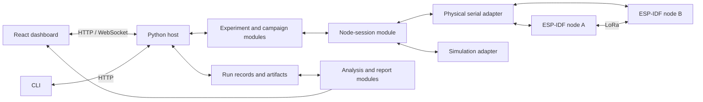

# Complete testbed implementation plan

> Historical document. The November 1 physical-only decision supersedes the
> simulator workflows and commands below; those implementations were removed.
> See [current status](status.md) and [host usage](../testbed/README.md).

Prepared October 18, 2026. Target: release candidate December 1; delivery and
demonstration during the first week of December 2026.

This is the implementation roadmap for the complete requested scope. It extends
the original host design and supersedes its proposed milestone order. The CDR
and `test_experiment_catalog.md` remain the requirements and experiment sources.
Items below are planned unless explicitly listed as implemented. Firmware dates
are proposed integration targets, not commitments already made by its developer.

Contract update, October 18: the user delegated all contract decisions for now.
`testbed_contract_v2.md` and `../contracts/v2/default_profile.json` select the
implementation baseline. These decisions supersede earlier calls to select or
agree a contract before proceeding. Homar's later review can produce a versioned
revision; it is not a prerequisite to implement this baseline.

## 1. Delivery outcome and present baseline

Deliver a local macOS application in which the operator can connect ESP-IDF
nodes, inspect their live state, configure and execute every CDR experiment,
monitor measurements, compare results, and export reproducible evidence. Provide
the same operations through the CLI. Include physical voice capture, compressed
voice transport, playback, and feasibility evaluation in the final scope.

The user will initially attach one ESP32, with no microphone or speaker attached.
Its precise board model, radio availability, and firmware are still unconfirmed.
The planned final RF bench remains two Heltec WiFi LoRa 32 V4 nodes. A generic
ESP32 must not be assumed to contain a LoRa radio. The first board can validate
serial control and telemetry after compatible firmware is installed. A second
radio-equipped node is necessary for two-node RF measurements; the audio
peripherals are necessary to close physical capture/playback coverage.

| Area | Available now | Work required for completion |
| --- | --- | --- |
| Application | FastAPI/Python, React/TypeScript, CLI, local serving | Complete workflows, typed interfaces, diagnostics and deployment procedure |
| Appearance | Four workspaces, persistent light/dark toggle | Cohesive design tokens, responsive layout, accessibility and operational UX |
| Nodes | Simulated pair; serial port listing | Independent physical sessions, identification, health and live telemetry |
| Experiments | Simulated IF-02 metadata; all 23 entries listed | All executable runners, actual payload verification, campaigns and assessments |
| Results | SQLite events/runs, basic live chart, CSV/JSON/JSONL | Complete metrics, interactive plots, comparisons, coverage and report bundles |
| Voice | WAV validation, reference storage, waveform and playback | Firmware transfers, codec, capture, RF delivery, decode, playback and analysis |
| Reliability | Run ownership, cancellation and interrupted-run recovery | Serial/reset faults, telemetry gaps, bounded hardware runs and long-session validation |

The current IF-02 simulator does not establish payload correctness, radio
performance, security, or codec behavior. A listed catalog entry is not an
implemented experiment. A host-complete runner is not hardware evidence.

## 2. Application architecture and implementation approach

Retain Python/FastAPI, React/TypeScript/Vite, pySerial, SQLite and Typer. Add
Apache ECharts for interactive plots and Python plotting for reproducible report
figures. ECharts supplies line, scatter, boxplot and heatmap charts with zoom,
tooltips and linked exploration, matching this application's needs.
[ECharts features](https://echarts.apache.org/en/feature.html)

One backend owns the serial ports and the active bench. UI and CLI both use its
HTTP interface; WebSocket updates carry current state and measurement changes.
Node firmware performs timed packet/audio work; browser and USB scheduling do
not determine RF pacing or measured on-node latency.

| Module | Small interface | Behavior owned by its implementation |
| --- | --- | --- |
| Node sessions | discover, connect, request, events, disconnect | Serial ownership, identity, boot/session state, deadlines, capability validation and reconnection |
| Experiment execution | preview, start, stop, inspect | Preconditions, applied settings, receiver arming, finite runs, drain, summaries, cleanup and assertions |
| Campaign execution | preview, enqueue, stop, inspect | Sweeps, repetitions, order, baseline controls, progress and durable case tracking |
| Run records | append, finalize, query, export | Event history, schema migrations, provenance, artifact integrity and restart recovery |
| Analysis | summarize, compare, predict | Metric definitions, validity, uncertainty, deduplication and aggregation |
| Audio | register, transfer, inspect, compare | Bounded artifacts, codec metadata, stage timing and listening evidence |
| Coverage | requirements, readiness, evidence | The mapping from every CDR case to firmware support, host support and hardware evidence |

Refactor incrementally at these interfaces: replace `Host`'s direct dependency
on `SimulatedPair` with the node-session module, then move orchestration into
experiment execution. Keep physical and simulated adapters behind the same
protocol contract. Split the large frontend entry file into views, forms,
node displays, charts and host-state handling as the corresponding work ships.
Generate frontend types from the host schema to avoid separately maintained
field definitions. Avoid a general plugin framework for this two-node bench.

## 3. Hardware connection and ESP-IDF contract

### First attached ESP32

1. Inventory its USB port, VID/PID, USB serial number where present, board/chip,
   current firmware and available peripherals. Distinguish USB descriptors from
   identity reported by compatible application firmware.
2. Use the selected ESP-IDF v6.0.2 release and an identified board manifest.
   Validate the installed toolchain and build on the actual chip target.
3. Prepare a small ESP-IDF diagnostic firmware target with the selected v2 serial
   contract: identity, boot ID, ping, status, capabilities, heartbeat, memory
   statistics, structured errors and finite diagnostic operations. Make its
   protocol/telemetry code reusable in Homar's node firmware.
4. Build for the identified target, record the image/build identity and flash
   the selected test board as a separate, deliberate development operation.
   Release the host's port before flashing or using IDF Monitor, then reconnect
   and verify the running build. Connecting a device never automatically flashes it.
5. Execute interface checks, show actual changing telemetry in the dashboard,
   and preserve a diagnostic report. Repeat through unplug/replug and reboot.

Support zero, one or two connected nodes independently. Assign logical A/B roles
to persistent device identity; a changed macOS port path must not swap identities.
Enumerate ports for selection, then handshake with the selected device. Display
an occupied port, unsupported firmware, timeout or incompatible version as a
specific connection outcome.

ESP32-S3 can expose USB Serial/JTAG directly, and its macOS device normally
appears under `/dev/cu*`; boards may instead route through a USB-UART bridge.
Choose transport and reset-line behavior after identifying the board, and test
re-enumeration rather than assuming opening a port preserves boot state.
[Espressif USB Serial/JTAG guide](https://docs.espressif.com/projects/esp-idf/en/stable/esp32s3/api-guides/usb-serial-jtag-console.html)

### Contract to freeze before RF integration

- Versioned, bounded NDJSON commands, replies and events; retain the 4096-byte
  record limit initially. Specify units, ranges, required fields, compatibility
  rules, structured error codes and examples for host and C conformance tests.
- Persistent device ID, per-boot ID, firmware version/commit/build, ESP-IDF
  version, board/chip and actual peripherals. Capability declarations include
  supported radio profiles, security, codec/audio formats and buffer limits.
- Command correlation, per-session idempotence rules, command deadlines and
  bounded retry behavior. Reject stale runs and commands after a boot change.
- Read applied settings back from both nodes; requested settings alone never
  establish configuration. Reconcile mismatches before arming the receiver.
- Transfer the complete run specification to firmware, including count, pacing,
  maximum duration, stop behavior, drain interval and summary requirements.
- Timestamp each event with node uptime, boot ID, monotonic event sequence,
  run ID, event name and typed data. Record host receipt time separately.
- Final sender and receiver summaries, event-drop counters, unexpected reset
  causes and error stages. Reconcile summaries with individual observations.
- Independent state for transport connection, protocol compatibility, readiness
  and current activity. Connected does not automatically mean ready.
- Explicit command/event families for radio, security, message fragments,
  acknowledgments, timing calibration, memory, audio and artifact transfer.
- Audio chunks carry artifact ID, offset, length and checksum; final artifacts
  carry total length and hash. Support cancellation and bounded retention.
- Structured diagnostics on the protocol stream or a separate log channel;
  handle boot text and malformed input without mistaking them for measurements.

Proposed health defaults: one heartbeat per second, stale after three missed
heartbeats, and a disconnected/unresponsive indication after a five-second
deadline. Validate and adjust these during bring-up. Heartbeat loss interrupts
an active run; firmware's finite-run limit provides independent termination.
Reconnection restores visibility, and requires a new preflight before a new run.

## 4. Modern UI/UX and live node information

The design direction is a compact laboratory instrument dashboard: clear visual
hierarchy, consistent spacing, subdued surfaces, readable typography, strong
chart contrast and visible operational state. Retain light/dark preference and
system defaults, replacing scattered overrides with shared semantic tokens.
Use consistent node colors, units and status vocabulary throughout the app.

### Workspaces

| Workspace | Main workflow and changes |
| --- | --- |
| Bench | Connect devices, see a host–A–B topology, inspect node cards, select a node for a detail drawer, view live health and begin a compatible test |
| Experiments | Search the full catalog, inspect requirements, choose preset, configure nodes/settings, preview cases and duration, preflight and run |
| Run monitor | Open from any workspace through a persistent run bar; show stage, direction, progress, live charts, errors and stop/save-partial action |
| Voice | Choose a reference or node capture, configure codec, inspect size/airtime preview, execute stages, compare recovered audio and record listening notes |
| Results | Filter saved runs/campaigns, inspect summaries and charts, compare settings/outcomes, rerun a configuration and export evidence |
| Coverage and diagnostics | Reach through Experiments/Bench; show required tests, readiness, evidence, blockers and timestamped filtered diagnostics |

The bench layout places connection/mode state at the top, node A and B around a
link diagram, current-run metrics beneath them, and recent activity/results
below. With one board attached, show its real data and an explicit empty peer
slot. Replace the current promotional content with readiness and useful activity.
The link diagram reflects telemetry and states; decorative animation must not
imply packet delivery that has not been observed.

### Node data to display

| Group | Fields and presentation |
| --- | --- |
| Identity | Logical role, persistent device ID, board/chip, USB port and transport, firmware/build, ESP-IDF and protocol version |
| Health | Connection/ready/activity states, last seen and data age, uptime, boot ID, reset cause, command failures and telemetry drops |
| Radio | Detected radio, applied frequency, SF, bandwidth, coding rate, TX power, preamble/header/CRC settings and supported limits |
| Traffic | TX attempts, original packets, unique accepted RX, duplicates, retries, ACK timeouts, rejected packets, last RSSI/SNR and trends |
| Memory | Free/minimum heap, largest free block, stage buffer allocations and separate internal RAM/PSRAM where supported |
| Security | Enabled profile, non-secret session/key-readiness state, authentication/replay counters; no secret keys in UI or exports |
| Audio | Microphone/output presence, supported format/codec, capture/playback state, sample counts and buffers when advertised |
| Run context | Current run, sender/receiver role, requested versus applied configuration and outstanding command/stage |

Show unsupported data as “Not supported”, absent samples as “No data”, and stale
values with their last-update time. Do not substitute a zero or a fabricated
sensor value. Packet RSSI/SNR has its own age because an idle node's heartbeat
does not make an old radio measurement fresh. Separate lifetime/boot counters
from current-run counters. Display host connection health independently from
each node's serial health.

### Interaction requirements

- Per-node connection controls and a clear Simulation/Hardware selector. A
  mixed physical/simulated setup, if used for integration checks, records each
  node's provenance and cannot satisfy two-node RF evidence.
- Presets before advanced settings; show derived airtime, packet budget,
  fragment count and expected duration before execution. Preserve form edits
  while telemetry updates. Explain each disabled action beside the control.
- Configuration/preflight/run/results is one guided path. Preflight checks
  node capabilities, roles, applied radio agreement, keys, resources and timing
  requirements. Failed checks identify the next corrective action.
- Persistent progress and stop control across navigation. Refresh/reopen restores
  the current run; switching pages does not change bench ownership.
- Loading, empty, unsupported, stale, disconnected, partial and failed states
  are designed alongside the successful state. Keep failure details and
  recovery actions available after a temporary notification disappears.
- Keyboard-operable controls, visible focus, labeled inputs, text plus color
  for status, reduced motion, accessible chart summaries and tabular equivalents.
- Validate light/dark layouts at 1280×720, a typical Mac laptop width and a
  narrow viewport; keep primary controls usable without horizontal page overflow.

## 5. Measurement and visualization implementation

All plots use persisted measurement data and common Python metric definitions.
Live data is provisional until drain and final summaries complete. Every chart
shows units, direction, run/configuration, sample count and measurement basis.
Mark telemetry gaps and invalid intervals, including in exported figures.

| Result | Visualization | Required interaction/evidence |
| --- | --- | --- |
| Packet delivery and useful throughput | Time-series plots and outcome counts | Choose node/direction/window; distinguish originals, attempts and duplicates |
| RF sweeps | Metric versus SF/BW/coding rate/power; selected two-factor heatmaps | Hover applied settings, inspect repetitions, compare a matched baseline |
| RSSI and SNR | Time trends, histograms/boxplots and delivery scatterplots | Show sample counts and missing-signal samples; do not infer RF loss from absent serial events |
| Latency | RTT histogram/ECDF, median/p95 and timeout counts | Include timestamp definition; show calibrated one-way latency with uncertainty separately |
| Security | Accepted/rejected outcome chart, injection event timeline, crypto-time distributions | Drill from assertion to frame identity, receiver stage and legitimate control |
| Fragmentation and retries | Fragment-index grid/timeline and attempt/reassembly views | Inspect missing, reordered, repeated and retried fragments and whole-message digest |
| Memory | Internal/external heap and buffer timelines with stage markers | Correlate minima, largest block, allocation failures and audio/message stage |
| Voice | Source/recovered waveforms, stage-duration chart, bitrate/goodput and backlog trends | Play corresponding clips, inspect artifact provenance and listening rubric |
| Timing model | Predicted/observed scatter and residual plots | Inspect full on-air sizes, model version, ACK/retry/pacing assumptions |
| Campaign and coverage | Case matrix and evidence table | Open a run, failed assertion or blocker from each cell |

Use zoom, pan, legend selection and shared cursors where useful. Provide reset
view and download data actions. Limit initial comparison to four selected runs,
with a configuration-difference table before plots. Warn when firmware, direction,
payload, security, environment or timing definitions make a comparison unmatched.
Allow exploration while preserving those differences in exported reports.

Coalesce live drawing to 2–5 updates/second, bound visible event buffers and
downsample long traces for display. Preserve full captured data for analysis and
export. Replace full-history WebSocket snapshots with bounded snapshots/deltas
and paginated run/event queries; reconnect using a snapshot/cursor. A dropped UI
update must not discard the underlying recorded measurement.

For repetitions, show each run and its variability before offering aggregates.
Distinguish pooled packet statistics from per-run averages. Do not claim
statistical significance or a precise p95 from inadequate samples. Performance
experiments remain exploratory unless a target is explicitly agreed.

## 6. Run engine, campaigns, storage and analysis

Implement a common execution state machine: validating → configuring → arming →
running → draining → finalizing → completed. Preserve cancelled, failed,
interrupted and blocked outcomes, and keep pass/fail/inconclusive/not-assessed
separate from execution status. Record the original failure and cleanup failures
separately so cleanup cannot erase the reason a run stopped.

Each runner declares required capabilities, validated parameters, setup,
execution, measurement definitions and assertions. Finalization accounts for
late observations within the bounded drain period. Firmware enforces finite
count/duration even if the host disappears. Stop deadlines include the supported
in-flight radio operation and are documented per profile.

Campaigns provide single-factor sweeps, selected combinations, both directions,
repetitions, baseline controls and seeded run order. Preview the complete case
list, duration and resources; save preset, seed, order and campaign ID. Start
data presets at 100 original packets and three repetitions, then adjust after
airtime/runtime measurements. Voice starts with three repetitions of a fixed
three-second clip. These are initial experiment settings, not performance targets.

Allow pause between cases, cancel active/queued work and rerun selected cases as
a new campaign linked to the original. Halt on node/reset/configuration faults;
save all completed and partial cases. A restart never silently resumes RF work.
Keep invalid or blocked cases visible rather than dropping them from the matrix.

Store device sessions, capabilities, requested/applied settings, firmware/build,
host/protocol/analysis versions, runs, campaigns, events, summaries, calibration,
artifacts, annotations and coverage evidence. Add explicit database migrations
and preserve existing simulated runs. Record boot IDs, environment/placement
notes, clock domains, raw units and validity reasons. Use atomic artifact writes,
hash checks and a workspace backup/export procedure.

Persist events before they become expendable UI updates; use a bounded ingestion
queue and deliberate SQLite batching outside the serial read path. Count and
surface both firmware and host drops, storage errors and telemetry overload.
If loss prevents a metric from being established, report it as incomplete; do
not classify missing USB observations as RF packet loss.

Metric rules include unique valid delivery over confirmed original TX, attempt
counts separate from retries, and useful accepted payload bits over a documented
measurement interval. Host wall-clock duration is a separate operational metric.
Apply known-data content/digest validation. Handle empty samples and zero
denominators as unavailable. Recompute summaries from stored events using a
versioned analysis module and flag disagreements with firmware summaries.

Export individual runs and campaigns as CSV, JSON/JSONL, static PNG/SVG plots,
WAV/encoded artifacts and a ZIP evidence bundle. Include an HTML report suitable
for printing to PDF, configuration differences, coverage ledger, hashes and raw
event references. Report figures are generated from the same analyzed datasets
as the UI. Add matching CLI commands for nodes, presets, campaigns, coverage,
analysis and export, including machine-readable output and meaningful exit codes.

## 7. Complete experiment implementation map

All 23 entries must have a host workflow, measurement/assessment implementation,
test coverage and an evidence record. Detailed controls and CDR references remain
in `test_experiment_catalog.md`; this table supplies delivery gates.

| ID | Implemented behavior and evidence required to close the case | Hardware gate |
| --- | --- | --- |
| IF-01 | Valid/invalid commands, partial/malformed frames, timeouts, command correlation, version mismatch and serial recovery | One board with protocol firmware |
| IF-02 | Known payloads A→B and B→A; content validation, unique counts and final summaries | Two LoRa nodes |
| IF-03 | Configure and execute a repeatable campaign, stop/recover, preserve all case results | Two LoRa nodes plus campaign-capable firmware |
| RF-01 | SF sweep with fixed controls, repeated PDR/goodput/signal/latency results | Two LoRa nodes |
| RF-02 | Bandwidth sweep with actual applied settings and paired baselines | Two LoRa nodes |
| RF-03 | Coding-rate sweep with repeatability and uncertainty/sample counts | Two LoRa nodes |
| RF-04 | TX-power sweep with fixed bench placement and radio configuration | Two LoRa nodes |
| SEC-01 | Protected/unprotected matched runs and correct legitimate delivery | Two nodes with security profile |
| SEC-02 | Alter protected content/tag after protection, reach authentication and demonstrate rejection, with legitimate control | Two nodes with controlled injection and receiver-stage evidence |
| SEC-03 | First accept a legitimate frame, replay that exact protected frame and demonstrate no second application delivery | Two nodes with replay state and retained-frame injection |
| SEC-04 | Encryption/decryption timings by size/profile with clock resolution and unprotected baseline | One node can validate crypto locally; paired link comparison uses two |
| PKT-01 | Sweep message sizes around fragment/buffer boundaries; verify reconstructed length/digest and completion | Two nodes with fragmentation |
| PKT-02 | Fragment-size sweeps plus controlled missing/duplicate/reordered fragments; bounded recovery/timeout | Two nodes with logical fault hooks |
| PKT-03 | ACK/retry policies, original/attempt counts, delivery, delay and retransmission cost | Two nodes with reliability instrumentation |
| TIME-01 | Sender-local echo RTT in each direction, distributions and timeouts | Two nodes with echo timestamps |
| TIME-02 | Validated clock calibration, paired TX/RX phases, uncertainty/drift and reset invalidation | Two nodes plus agreed synchronization reference and validation equipment |
| MEM-01 | Heap/buffer footprint by message/audio stage, limits, allocation failures and recovery | One node starts checks; full pipeline needs two and audio peripherals |
| VOICE-01 | Each node captures and locally plays three seconds of 8 kHz/16-bit mono; save samples, timing and listening evidence | Microphone, amplifier/speaker and I2S firmware on each node |
| VOICE-02 | Encode, protect/fragment, RF-send, reassemble, decode/play and compare with matched known-data runs | Two LoRa nodes, codec and complete audio path |
| VOICE-03 | Sustained encoded goodput versus source rate, backlog/underflow and completion fraction | Two nodes and codec/source-rate instrumentation |
| VOICE-04 | Stage and valid end-to-end delays, recovered clips and reproducible intelligibility rubric | Full audio path; synchronization for cross-node one-way timing |
| MODEL-01 | Validate airtime/fragment/delivery model against actual lengths and measured timings across profiles | Model fixtures first; RF validation needs two nodes |
| OPS-01 | Disconnect, reset, config failure, telemetry/storage faults and stable repeat baseline; preserve partial evidence | One board starts checks; final cases cover two-node operation |

Security and retry behavior must be designed together. A valid retransmission
may need another ACK while producing no duplicate application delivery; record
this separately from a replay attack. Define key readiness, nonce uniqueness
across resets/sessions, authentication coverage, replay window, session changes
and counter exhaustion with firmware. Test a vetted authenticated-encryption
implementation using known-answer and negative cases. Export only non-secret
profile/session identifiers. A radio CRC rejection is not authentication evidence.

Use node-local timestamps around crypto and echo operations. ESP-IDF's
`esp_timer_get_time()` supports fine-grained monotonic timing, but its resolution
does not establish synchronization or total measurement accuracy.
[ESP Timer documentation](https://docs.espressif.com/projects/esp-idf/en/v6.0.2/esp32s3/api-reference/system/esp_timer.html)

Implement the selected TIME-02 wired pulse calibration: Node A drives capture
inputs on both nodes, with 32 paired edges and continuing 10 Hz reference pulses.
Validate capture latency with bench timing equipment as specified in v2. Record
offset, drift, event phases and uncertainty;
invalidate calibration on reset or expiry. USB receipt-time subtraction is not
an acceptable substitute for this measurement.

Collect heap free space, minimum free space and largest free block by memory
capability, plus explicit stage allocations and failures. ESP-IDF provides these
heap measurements; availability of external RAM must be discovered on the board.
[ESP-IDF heap diagnostics](https://docs.espressif.com/projects/esp-idf/en/stable/esp32s3/api-reference/system/heap_debug.html)

## 8. Voice implementation with peripherals arriving later

Build the reference-based host workflow now and attach physical stages as the
hardware becomes available. The selected codec is Codec 2 1.2.0, mode 3200.
Implement and benchmark its ESP-IDF build, memory and encode/decode path; record
the source/build provenance. An unsuitable measured result requires an explicit
contract revision, not an unreported codec substitution.

Implement bounded source upload, node encode, protected fragmented transfer,
reassembly, decode, artifact retrieval and playback. Add microphone capture and
speaker playback through the board's I2S configuration; verify pin allocation
against radio/display wiring before integration. ESP-IDF exposes I2S RX/TX
interfaces for this work.
[I2S documentation](https://docs.espressif.com/projects/esp-idf/en/v6.0.2/esp32s3/api-reference/peripherals/i2s.html)

The baseline is 24,000 samples and 48,000 raw PCM bytes for three seconds. Save
raw/encoded lengths, codec version/mode, sample/frame counts, stage buffers and
artifact hashes. Compute RF fragments from actual encoded bytes after accounting
for all framing/authentication overhead. Validate the CDR arithmetic and modem
formula against the identified radio's documentation and independent vectors.

Upload sources before and retrieve artifacts after the timed RF window. Verify
the encoded message digest at each end; lossy decoded PCM does not require byte
equality with the source. Record truncation/concealment and playback errors.
Measure capture, encode, queue, transmit, reassembly, decode and playback stages.
Keep valid calibrated end-to-end delay separate from host-observed completion.

Compare voice/data both at equal useful bytes and as their actual declared
application workloads. For sustained feasibility, compare delivered encoded
goodput with source bitrate and observed buffer growth/underflow. A delayed clip
can succeed even when continuous voice is infeasible; report that measured outcome.
Save a fixed listening rubric, clip ordering, ratings and notes. Browser audio
inspection assists analysis; physical microphone/speaker validation remains open
until those devices have been tested.

## 9. Verification and completion criteria

| Layer | Verification and exit evidence |
| --- | --- |
| Protocol | Shared golden command/event fixtures; host/C agreement; framing, schema, ordering, idempotence, timeout and reset tests |
| Host workflows | Repeatable simulation of every runner and expected failure; real payload checks; stop/drain/finalization and concurrent-start tests |
| Measurement | Independent known-count/time vectors, duplicates, late events, retries, zero delivery, missing telemetry, clock invalidation and artifact corruption |
| Persistence | Migration of current data, crash/restart, partial writes, storage failure and reproducible export/reanalysis |
| UI | Connect one/two nodes, configure/run/stop, navigate/refresh during run, compare/export, voice workflow, errors and recovery in both themes |
| Hardware | One-board protocol/health checks, then two-node bidirectional data, security/packet suites, calibrated timing and complete audio path |
| Sustained operation | Proposed 60-minute capture and 100-case synthetic campaign, bounded memory/UI buffers, responsive stop, no unreported telemetry loss |
| Release | All 23 catalog entries trace to executed hardware cases and evidence; correctness assertions pass, performance findings are reported honestly |

Proposed UI acceptance targets: healthy node telemetry appears within two seconds
of receipt; stop is acknowledged in the UI promptly and its hardware termination
deadline is visible; chart interaction remains usable during the sustained test.
Measure these on the development Mac. They are software responsiveness targets,
not promises about RF latency. Validate the host ingest rate against the maximum
advertised firmware telemetry rate with headroom.

Run Python tests/lint, TypeScript checks, formatting and production build for
relevant implementation changes. Add browser regression coverage for critical
operator journeys and visual checks of both themes. Add ESP-IDF build/protocol
checks and an opt-in hardware suite addressed to explicit device IDs. Hardware
tests must not execute against arbitrary attached serial devices.

The coverage ledger records host implementation, firmware capability, hardware
prerequisite, case specification, execution status, assessment, evidence run IDs,
owner and blocker separately. Each catalog entry can contain multiple required
cases; one row-level run does not close unexecuted directions or fault cases.
Blocked/inconclusive required cases remain incomplete. An unfavorable measured
voice feasibility or RF performance result can be a valid completed experiment.

## 10. Delivery sequence, ownership and gates

Host implementation and UI are Angel's scope; firmware, RF/security/audio and
peripheral integration remain Homar's CDR scope. The diagnostic firmware target,
protocol, timing definitions and integration tests follow the selected v2 baseline
and will be reviewed together.
Implementation assistance can cover host work and the diagnostic target without
assuming that production firmware already exists or changing ownership silently.

| Dates, 2026 | Host/UI deliverable | Firmware/hardware dependency | Exit gate |
| --- | --- | --- | --- |
| Oct 18–23 | Implement v2 schema/fixtures; device sessions; independent connection UI; single-node detail view; design tokens and screen layouts | Identify attached board, build diagnostic firmware; validate selected security/codec/sync choices and complete dependency list | One real board shows identity, uptime, memory and health; IF-01 baseline passes |
| Oct 24–30 | Complete bench redesign/run monitor, typed forms, event persistence upgrades; IF-02 content validation, initial live charts; campaign foundation | Second radio node and known-data TX/RX with summaries; implement v2 codec/security profiles and timing reference | Known bytes travel in both directions and results survive refresh/restart |
| Oct 31–Nov 6 | Campaign preview/repetitions/order, RF-01–04, RTT, memory and model plots; Results filtering and comparison | Radio controls, echo/memory telemetry; synchronization fixture available; audio codec and I2S bring-up | Repeatable RF campaign with exported charts; codec benchmark and calibration method demonstrated |
| Nov 7–13 | SEC-01–04 and PKT-01–03, negative-case timelines; voice transfer UI and artifacts; TIME-02 runner | Crypto/replay/injection/reliability, calibrated timestamps; microphone/speaker hardware installed and local audio functional | Security/fragment assertions and local audio verified; first complete voice RF trial |
| Nov 14–20 | VOICE-01–04, model validation, OPS-01, full coverage dashboard and report bundles | All required firmware capabilities and peripherals | Every required category has its first hardware execution; failures and missing cases are visible |
| Nov 21–27 | Repeat campaigns, fill case-level gaps, resolve failures, performance/accessibility checks and documentation | Stable integrated firmware; reproducible bench conditions | Required correctness cases pass; measurements and voice findings are reproducible |
| Nov 28–Dec 1 | Freeze versions/presets, clean setup rehearsal, final evidence export and demonstration rehearsal | Final board/build/wiring records | Release candidate with complete evidence ledger and operator guide |
| Dec 2–7 | Delivery buffer, demonstration fixes and final packaging | Bench availability | Deliver during the agreed first week of December |

The critical path is shared contract → one-board protocol → two-node known-data
link → security/fragmentation/codec instrumentation → full hardware experiments
→ repeated evidence. UI development and simulated workflows can proceed while
firmware is developed, but cannot replace these hardware gates.

The schedule assumes both owners can work through these milestones; availability
has not been estimated in hours. With roughly six weeks to the release target,
it is aggressive. If the second node slips past October 30, or audio/timing
hardware past November 6, revise dates and expose the affected coverage; retain
the requested experiments. Prioritize finishing the integrated paths and defer
cosmetic extras before considering any explicit scope change.

## 11. Implementation batches and first concrete deliverable

Implement and verify these reviewable batches in dependency order. UI work ships
with the corresponding real workflow rather than waiting for a final polish phase.

1. Contract fixtures, device identity/capability/state models and diagnostic target.
2. Physical serial adapter, per-device session ownership, independent connect and
   health recovery; preserve existing simulation through the same interface.
3. Design tokens, modern bench/topology, port chooser and live node drawer.
4. Generic run state machine, schema migrations, typed frontend interface and
   validated real IF-02 with persistent run monitor.
5. Shared analysis datasets, interactive chart module, result detail/filtering,
   configuration comparisons and export primitives.
6. Campaigns, presets, radio sweeps, RTT/memory instrumentation and timing model.
7. Security/fragment/retry runners and their controlled failure visualizations.
8. Calibration and synchronized timing, with explicit validity and uncertainty.
9. Full voice workflow, peripherals, artifacts and the four voice experiments.
10. Coverage ledger, report bundles, reliability/accessibility checks, clean setup
    instructions, wiring/build records and demonstration evidence.

The first concrete deliverable is a **real single-ESP32 dashboard**: select a
port, connect, identify the board, show actual uptime/heap/firmware/health, inspect
diagnostic events and recover from disconnect/reset. It requires no mic or
speaker. The empty second slot and unavailable RF/audio functions state exactly
which hardware or firmware capability is missing.

Outstanding inputs are the exact attached board/radio model, the second-node
availability date, audio-peripheral availability, firmware integration dates,
and timing-reference equipment. Technical contract choices are now selected in
v2; these physical dependencies do not prevent beginning single-board host work.
