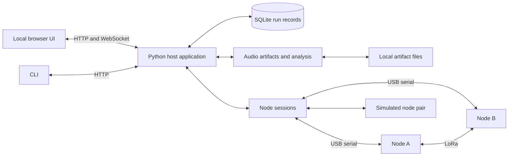

# Host testbed design proposal

> Historical document. The November 1 physical-only decision supersedes the
> simulator workflows and commands below; those implementations were removed.
> See [current status](status.md) and [host usage](../testbed/README.md).

Draft: October 17, 2026. This is a design proposal, not an implemented system.
Later decisions: `testbed_contract_v2.md` selects the provisional interfaces,
security, codec and timing policy under the user's October 18 delegation.
`full_implementation_plan.md` is the current delivery roadmap. Historical
selection/agreement language below does not block implementing that baseline.
Project baseline: `secure_lora_comms_testbed_cdr.pdf` in this directory.
Revised scope: voice and the full CDR experiment set are included. The earlier
data-only scope is superseded. See `test_experiment_catalog.md` for traceability.

## Confirmed requirements

- macOS host; UI is the main operator interface, with a supporting CLI.
- No firmware exists yet.
- Node firmware will use ESP-IDF, as confirmed by the user.
- Include voice capture/transport/playback and analysis in this planned version.
- Include every experiment and validation category described in the CDR.
- Developer is comfortable with Python and web development.
- Delivery deadline is the first week of December 2026.

Working assumption: both active nodes connect by USB to the same Mac. Confirm
this before implementing hardware discovery. The suggested internal target is
December 1, leaving time for demonstration preparation and fixes.

## Proposed first version

An operator can connect two nodes, configure an experiment, run it, monitor
progress, inspect results, and compare/export saved runs for data and voice. The
same workflow works with explicitly labeled simulated nodes before hardware
firmware is available. Implementation is incremental; the planned delivery scope
includes the complete catalog, not just the earliest implemented experiments.

Four main UI views:

1. **Bench:** two node cards showing port, identity, firmware/protocol version,
   connection/ready state, supported capabilities, and confirmed radio settings.
   Provide connection controls and a bounded diagnostic event console.
2. **Experiments:** choose Radio, Security, Packet Handling, Timing, Memory, or
   Voice suites from the complete experiment catalog. Select a saved preset or
   configure direction, radio settings, payload size, packet count/pacing,
   security mode, acknowledgment/retry strategy, fragmentation, and repetitions. Preview
   estimated batch duration and configuration count, then start/stop. Show the
   current configuration, batch progress, metric cards, charts, and errors.
3. **Voice:** configure node microphone capture or a repeatable uploaded reference
   clip, select an advertised codec/mode, inspect original/encoded size and
   estimated fragments/airtime, record, send, monitor fragment progress, and
   retrieve/play the received clip. Compare reference and recovered audio with
   waveforms, stage timings, memory measurements, and a saved listening rubric.
4. **Results:** saved runs with settings and completion status; drill into plots,
   compare selected runs, add notes, and export CSV, JSON/JSONL, plot PNGs, WAV
   clips, and encoded audio artifacts with a manifest.

Keep advanced settings collapsed. Show simulated mode prominently. Display the
entire CDR catalog, including blocked experiments and their missing requirements.
Enable execution only when both nodes advertise the necessary capabilities. A node may be
connected without being ready to run; incompatible protocol versions, failed
configuration, and missing capabilities must be visible.

## Architecture and suggested stack

- Python backend using FastAPI for commands, state snapshots, and live updates.
- React + TypeScript with Vite for the dashboard.
- pySerial for serial access, using finite read/write timeouts and worker threads
  to keep blocking I/O out of the backend event loop.
- Typer CLI as a client of the running backend; it never opens the ports itself.
- SQLite for local persistence and Python for metric computation/plot export.
- Serve the built frontend locally from the backend. During development, the
  frontend can use its development server. Bind the host application to loopback.

One backend process owns both serial ports and the active experiment. UI refresh
or closure must not stop a run; the reconnecting UI fetches the current snapshot.
Only one batch runs at a time. Concurrent start requests return a clear conflict.

Suggested modules:

| Module | Small interface | Complexity it owns |
| --- | --- | --- |
| Node sessions | discover/connect, request command, consume events, disconnect | Identity, framing, command correlation, deadlines, serial faults, capabilities |
| Experiment runner | validate/preview, start, stop, inspect state | Two-node coordination, run states, pacing policy, bounded cleanup, batch progression |
| Run records | create run, append events, finalize, query/export | Configuration snapshots, durable event history, provenance, interrupted runs |
| Analysis | summarize run, compare runs | Deduplication, metric definitions, validity checks, plots |
| Audio artifacts | register reference, retrieve node artifact, inspect/compare/export | WAV metadata, codec provenance, chunked retrieval, file integrity, stage timing, listening evidence |

The node-session interface has a real implementation seam: serial and simulator
adapters. Both must exercise the same versioned command/event schema. The UI and
CLI call the same host operations, keeping measurement rules in Python.

Serial records are persisted before they become expendable UI updates. Bound UI
buffers and coalesce chart updates (initial target: 2-5 updates/second). If host
ingestion or node telemetry overflows, record the gap and mark affected metrics
incomplete; never silently treat missing telemetry as RF loss.

## Experiment coverage and automation

`test_experiment_catalog.md` defines every planned suite, its CDR reference,
controls, measurements, firmware dependencies, and required evidence. It includes
all six section 7.2 experiment groups and the additional measurements and tests
in sections 1.3, 5.4, 6, and 7.1. Catalog coverage is a release requirement.

Support manual single runs, suite presets, and queued campaigns. Every catalog
experiment is selectable from the UI and CLI. Sweeps support spreading factor,
bandwidth, coding rate, transmit power, security, message/fragment size,
acknowledgment/retry settings, and payload/codec mode. Frequency remains
configurable, as required by the CDR, within the agreed node capabilities.

Provide single-factor sweeps and explicit selected multi-factor combinations;
preview the complete run list and duration before execution. Do not require an
exhaustive Cartesian product to demonstrate coverage of the CDR experiments.
Begin data presets with 100 target packets and three repetitions per
configuration, revising after measured runtime. Voice presets repeat a fixed
three-second clip three times per selected configuration. Listening assessments
are a manual step attached to otherwise automated runs.

Preserve baseline controls when comparing configurations. Offer recorded/seeded
run order and repeated baseline runs to expose environment changes. Store bench
placement, antenna orientation, power source, and environment notes. Invalid
parameter pairs or unmet capabilities produce a blocked case with a reason;
never silently omit it from a campaign or count it as passing.

Compute conservative pacing and duration previews using the full on-air packet
size and validated radio timing model. Include framing/security overhead and
timeouts; do not apply a fixed packet rate to every radio configuration. Add a
per-run maximum duration and record the actual stop reason and packet count.

Campaigns are sequential, cancellable, and stop on node/configuration
failure. They do not silently reconnect and continue after a reset. Save a batch
ID, run order, repetition index, and all actual settings for every run.

## Measurements and saved evidence

| Measurement | Live UI | Saved analysis |
| --- | --- | --- |
| Transmitted, unique valid received, missing, duplicate counts | Counts and provisional delivery ratio | Final per-direction delivery ratio, after receive drain |
| Useful delivered bytes | Throughput trend | Run-average payload throughput |
| RSSI/SNR | Recent values and trend | Distribution and per-configuration comparisons |
| Node-measured round-trip delay | Recent value, if echo mode is supported | Median/p95, timeout count, successful sample count |
| Integrity/replay rejection and node errors | Counters/event console | Categorized counts and test outcomes |
| Serial faults, reboot, telemetry gaps | Visible run health | Completion status and metric-validity flags |
| Encryption/decryption processing time | Per-stage summaries | Distribution by payload size and security mode |
| Message/fragment reconstruction | Fragment progress and missing indexes | Completion rate, integrity, timeout/retry costs |
| Memory use and allocation failures | Heap/buffer usage at stage transitions | Peak SRAM/PSRAM, minimum free heap, largest free block |
| Voice rate, delivery/playback progress | Encoded rate vs measured goodput; stage status | Clip timings, success rate, intelligibility observations |
| Airtime/delivery prediction | Estimated duration | Predicted vs observed timing and model inputs |
| Synchronized one-way delay | Available only with valid clock calibration | Samples plus synchronization uncertainty and drift |

Metric rules:

- Delivery ratio = unique intended packets accepted by the receiver / unique
  original packets confirmed transmitted by the sender. Record transmission
  attempts/retries separately. Do not use requested packet count as proof of TX.
- Match packet identity using run, origin node, and packet sequence. Retries
  retain original packet identity. Separate radio reception from successful
  authentication and application acceptance so failures can be distinguished.
- Deduplicate useful delivered bytes. Record the measurement window explicitly;
  use sender-reported TX duration (and configured drain policy) for a documented
  run-level throughput convention. Mark unknown/inconsistent windows invalid.
- Show provisional metrics while running; finalize only after transmitter stop,
  bounded receiver drain, and final node summaries.
- Measure RF round-trip time on the originating node with its monotonic clock.
  Host command turnaround includes USB/processing delay and is a separate metric.
  RTT distributions include successful replies; display missing replies too.
- Keep bulk throughput and echo measurements in separate experiment modes so
  echo traffic does not silently alter the baseline traffic pattern.
- Zero denominators and unavailable measurements display as unavailable, not zero.
- Measure processing overhead on-node around the actual security operation, with
  the same clock and payload size; separate it from RF/serial wait time.
- Store message reconstruction outcomes separately from packet delivery ratio.
  For voice, validate reassembled encoded bytes before decoding; lossy decoded
  audio is not expected to equal the original PCM byte for byte.
- Initial timing uses RTT. The later synchronized one-way experiment remains
  part of the catalog and schedule; it requires documented calibration and an
  uncertainty bound. Host arrival timestamps alone do not establish one-way RF delay.

Store the requested scenario, confirmed settings from both nodes, node identity,
boot ID, firmware/protocol version, host software version, timestamps and units,
event sequence numbers, transmitted/received packet IDs, useful byte counts,
radio measurements, errors, final counters, completion reason, and operator notes.
Store host UTC receive time and monotonic timing separately from node timestamps.
Preserve the versioned raw event records so calculations can be reproduced later.
Simulated runs must remain distinguishable in storage, comparisons, and exports.

SQLite is the canonical run/event store. Audio/reference files live in per-run
artifact directories with hashes, format metadata, and database references.
CSV summaries, JSON metadata, JSONL event history, PNG figures, and WAV/encoded
audio files are exports. Saved results remain usable without
connected nodes. A host restart marks previously active runs interrupted.

## Voice workflow and measurement design

Voice is an explicit payload mode using the same security, packetization,
experiment runner, and analysis paths as data. Two sources are planned:

1. **Node microphone:** arm the receiver, trigger a three-second local capture,
   buffer and encode it on the sender, transmit fragments, reassemble/decode on
   the receiver, and play through the receiver's audio hardware.
2. **Reference clip:** validate a host WAV against an advertised node format,
   upload it before measurement, then execute the same on-node encode/RF/decode
   pipeline. This makes repeated codec and radio comparisons reproducible.

The default raw profile is 8,000 samples/second, 16-bit mono, three seconds:
48,000 bytes excluding file headers. Codec/mode selection is capability-driven;
Codec 2 is a CDR example, not a finalized dependency. The firmware owns the
measured codec and I2S processing; any host decoding is for offline inspection
and must be labeled with its implementation/version.

Capture -> encode -> fragment/protect -> RF transfer -> verify/reassemble ->
decode -> playback is represented as stage events tied to one message ID.
Retrieve original PCM (when available), sender encoded bytes, receiver encoded
bytes, and recovered PCM after measurement, using bounded serial artifact chunks
with transfer IDs, offsets, length, checksum/hash, and cancellation. Retain
bounded artifacts on the nodes until retrieval or explicit release. Negotiate
capacity before capture/upload. Do not transfer full PCM in unbounded event
records, or let USB artifact transfer masquerade as successful RF delivery.

Keep capture duration, encoding time, RF transfer time, reassembly time, decoding
time, and playback time separately. On-node stage durations use local clocks.
Cross-node delivery/playback latency requires calibrated clocks; until then show
a separately labeled host-observed workflow duration (including serial delay)
and a sender-measured message-completion RTT. Missing/failed stages stay explicit.

Compare sustained useful encoded-payload goodput (including configured security,
ACK, retry, and pacing effects) against encoded source bitrate. Delivering one
short recording eventually does not establish continuous voice feasibility.
Save a consistent qualitative rubric, e.g. unintelligible / partly intelligible /
mostly intelligible / clear, plus assessor and notes. Incomplete messages remain
failed/incomplete even if a decoder's declared concealment policy emits audio.

Calculate fragment count from the actual encoded message length and the
negotiated full packet budget, including framing, nonce/tag, and other overhead:
`ceil(encoded_bytes / useful_fragment_capacity)`. Keep the uncompressed reference
calculation separate. The CDR's 48,000/246 example has a quotient typo: it is
about 195.12 and requires 196 fragments before any additional overhead. Do not
hardcode that fragment count for compressed/protected voice.

Use a validated modem airtime model with complete on-air length, preamble, header,
CRC, SF, BW, coding rate, and optimization settings. Record model/version and
inputs. Compare predictions against node TX start/completion timings; total clip
delivery also includes processing, pacing, acknowledgments, retries, and receive
completion. Validate the CDR's printed timing formula before implementing it.

## Firmware contract to agree first

Propose UTF-8 newline-delimited JSON over USB serial. Freeze the actual schema
with Homar before either implementation depends on it. Suggested starting serial
settings are 115200 baud, 8N1, subject to the board's USB implementation.

The contract must specify:

- Protocol version, command ID, reply correlation, event type, stable node ID,
  boot ID, run ID, monotonic timestamps and units, event sequence, and errors.
- Maximum line length, numeric ranges, malformed-record handling, and diagnostic
  output handling. Partial reads are buffered; oversized lines resynchronize.
- Handshake/capabilities and readback of applied configuration.
- Commands for identity/status, configure, arm receiver, start sender, stop, and
  final run summary. Separate echo and security-injection commands by capability.
- Fragment/reassembly configuration and missing-fragment, duplicate, completion,
  timeout, ACK, retransmission, and per-message integrity events.
- On-node crypto timing, heap/buffer snapshots, allocation-failure reporting, and
  accurate TX timing instrumentation for processing/memory/airtime experiments.
- Audio capabilities (formats, codecs/modes, capture limits, artifact capacity),
  capture/encode/send/decode/playback commands, stage events, and bounded artifact
  upload/retrieval/release. Report actual sample counts, encoded lengths, and
  memory allocation per stage.
- Timestamp synchronization/calibration commands, clock resolution, drift and
  uncertainty metadata, and explicit invalidation on reset for one-way timing.
- Controlled altered/replayed-frame injection that can reach the intended
  integrity/replay check, with an injection ID and explicit rejection outcome.
- TX completion, RX validation, duplicates, security rejection, run completion,
  reset, telemetry-drop, and fault events; bounded summary counters per run.
- Radio units (e.g. frequency Hz, bandwidth Hz, TX power dBm), payload semantics,
  sequence wrap rules, timeouts, configuration acknowledgment semantics, and
  sender/receiver role assignment.
- Idempotent handling of repeated command IDs so a timeout/retry cannot start
  duplicate traffic. A reply means a defined state was reached, not just parsed.
- Receiver readiness before TX starts; finite traffic runs and a node-side
  maximum duration so host loss cannot leave traffic running indefinitely.
- Agreed packet metadata and security reporting. Encryption keys/nonces, replay
  state, reboot behavior, provisioning, and test injection need a separate shared
  security design; ordinary telemetry must not expose secret keys.

Host state progression: preparing -> receiver ready -> running -> stopping/draining
-> completed. Terminal alternatives: cancelled, failed, interrupted. Stop requests
are idempotent and cleanup is bounded. On failure, attempt to stop both nodes and
preserve partial data and the failure cause. Unsupported capabilities block the
affected experiment rather than presenting a fake success.

## Development and acceptance plan

| Dates (2026) | Target |
| --- | --- |
| Oct 17-23 | Freeze catalog and shared data/audio/security/timing contract; UI layout; simulator |
| Oct 24-30 | Simulated end-to-end data and voice workflows; run storage, artifacts, export; local node audio checks |
| Oct 31-Nov 6 | Real serial/configuration/data run; radio sweeps; node capture/encode and receiver decode/playback separately |
| Nov 7-13 | Security/injection, crypto timing, fragmentation, ACK/retry, memory instrumentation; real voice RF transfer; CLI |
| Nov 14-20 | Full data/voice comparisons; clock calibration and one-way timing; airtime validation; complete hardware catalog pass |
| Nov 21-27 | Repeat campaigns, qualitative listening, fault checks, report figures and reproducible instructions |
| Nov 28-Dec 1 | Rehearsal, fixes, release candidate |
| Dec 2-7 | Deadline buffer and final demonstration |

Hardware dates depend on node firmware delivery. A polished simulator cannot
replace the required two-node hardware demonstration. Firmware dependencies for
every catalog row must have an owner and integration date. Prioritize the basic
data path first while agreeing audio/instrumentation interfaces immediately.
Track blocked cases openly if integration slips; any scope reduction requires an
explicit user decision rather than silently dropping CDR tests.

Acceptance checks should exercise the externally useful workflow: two-node
discovery/configuration; reproducible run IDs/settings; exact metrics for a known
simulated loss/duplicate pattern; UI refresh during a run; a stop request; node
disconnect/reset; missing acknowledgment; serial partial/malformed records; and
saved-result exports. Extend these checks to the complete catalog: injection
outcomes, known reassembly patterns, retry accounting, processing/memory event
fixtures, audio artifact integrity and format validation, failed/incomplete voice,
and clock-calibration invalidation. Validate metrics against real node counters.

Release evidence must enumerate every catalog ID as passed, failed, blocked, or
inconclusive, with a reason and linked records. Exploratory performance tests
produce measured results rather than fabricated pass thresholds. Simulated and
hardware outcomes remain separate; simulator coverage does not close a hardware case.

Multi-node networking, remote hosting, and continuous high-quality real-time voice
are outside the CDR's two-node bench scope. Voice feasibility and synchronized
one-way measurement are included in the plan without promising a positive result.

## Primary technical references

These references verify framework capabilities; the architecture above is a
project-specific recommendation, not a requirement of those frameworks.

- FastAPI WebSockets: https://fastapi.tiangolo.com/advanced/websockets/
- FastAPI static files: https://fastapi.tiangolo.com/tutorial/static-files/
- Vite templates (including React/TypeScript): https://vite.dev/guide/
- pySerial interface and timeouts: https://pyserial.readthedocs.io/en/latest/pyserial_api.html
- Typer commands: https://typer.tiangolo.com/tutorial/typer-app/
