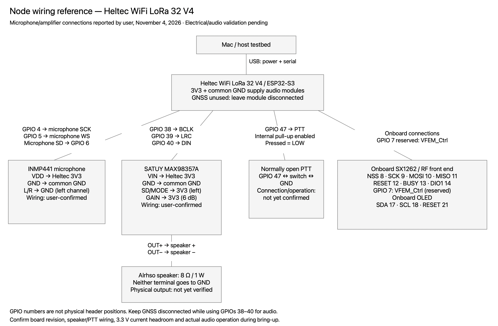

# Node hardware and wiring

User-confirmed hardware direction: Meshnology Heltec WiFi LoRa 32 V4 kit,
ESP32-S3, SX1262 / 915 MHz, 16 MiB flash and 2 MiB PSRAM. Exact printed board
revision still needs observation. The GNSS module will not be used; leave it
physically disconnected. On November 4 the user reported the ESP attached to this
laptop and microphone/amplifier wired to their assigned GPIOs. These connections
have not been independently verified. Speaker/PTT operation still needs confirmation.

All audio modules receive power from the Heltec board; amplifier VIN is 3.3 V.
The speaker is Alrhso, 8 ohm / 1 W. Amplifier: SATUY MAX98357A. Microphone: INMP441.
See `boards/heltec_wifi_lora32_v4.json` for machine-readable planning data.

| Module | Signal | Connection |
| --- | --- | --- |
| INMP441 | VDD / GND | Heltec 3V3 / GND |
| INMP441 | SCK / WS / SD | GPIO 4 / 5 / 6 |
| INMP441 | L/R | User-confirmed GND: left channel |
| MAX98357A | VIN / GND | Heltec 3V3 / GND |
| MAX98357A | BCLK / LRC / DIN | GPIO 38 / 39 / 40 |
| MAX98357A | SD/MODE | User-confirmed 3.3 V: enabled, left channel |
| MAX98357A | GAIN | User-confirmed 3.3 V: 6 dB |
| Speaker | Positive / negative | Amplifier OUT+ / OUT-; neither goes to GND |
| Normally open PTT | Signal / second terminal | GPIO 47 with internal pull-up / GND |
| Onboard SX1262 | NSS / SCK / MOSI / MISO | GPIO 8 / 9 / 10 / 11 |
| Onboard SX1262 | RESET / BUSY / DIO1 | GPIO 12 / 13 / 14 |
| Onboard RF front end | VFEM_Ctrl | GPIO 7 reserved; never use for PTT |
| Onboard OLED | SDA / SCL / RESET | GPIO 17 / 18 / 21 |

The board also has RF-front-end controls shown in the manufacturer's pin map
(GPIO 2 FEM_EN and GPIO 46 FEM_PA); preserve these when writing the board/radio
module and check the printed revision's schematic. Native USB uses GPIO 19/20.
The optional GNSS interface shares GPIO 38/39/40 used by the amplifier plan.

`reference/node-wiring.mmd` is the matching Mermaid source. It records planned
wiring; GPIO labels are not physical header positions. L/R, SD/MODE and 6 dB
GAIN straps are user-confirmed; actual electrical/audio operation remains unverified.
The board profile is not yet consumed by firmware or host capability detection.

## Open hardware checks

- Observe the printed board revision and verify its matching schematic.
- Confirm the delivered amplifier and microphone breakout resistor/enable wiring.
- Independently check the reported L/R, SD/MODE and GAIN straps before audio bring-up.
- Confirm speaker/PTT physical connections and their operation.
- Validate 3.3 V rail current headroom and voltage stability with radio/audio loads.
  The published V4 table lists 500 mA maximum 3.3 V output; it does not constitute
  measured headroom for this complete node. Speaker 1 W is a rating, not output proof.
- Verify actual peripherals, memory use and audio capture/playback, then retain
  hardware evidence separately from simulator results.

## Sources

- [Heltec V4 pin map](https://heltec.org/wp-content/uploads/2025/09/V4_pinmap-scaled.png)
- [Heltec V4 datasheet](https://resource.heltec.cn/download/WiFi_LoRa_32_V4/datasheet/WiFi_LoRa_32_V4.2.0.pdf)
- [Heltec V4.2 schematic](https://resource.heltec.cn/download/WiFi_LoRa_32_V4/Schematic/WiFi_LoRa_32_V4.2.pdf)
- [MAX98357A datasheet](https://www.analog.com/media/en/technical-documentation/data-sheets/max98357a-max98357b.pdf)
- [Amplifier listing](https://www.amazon.com/dp/B0GF67KXC3)
- [Microphone listing](https://www.amazon.com/dp/B0GFFFMDBW)
- [Speaker listing](https://www.amazon.com/dp/B0GX6GZFJ2)
- [Node kit listing](https://www.amazon.com/dp/B0FRS7H1FT)

Seller descriptions identify planned parts; they are not verified board schematics.

## USB inventory observation

On November 6, 2026, the laptop's USB/serial inventory showed Espressif's
USB JTAG/serial debug unit at `/dev/cu.usbmodem101`, USB serial
`F8:5B:1B:A2:77:44`, VID:PID `303a:1001`. The serial matches the previously
identified device `esp-f85b1ba27744`. This was an inventory-only observation:
no serial port was opened, firmware queried, reset requested or flash written.
The port previously appeared as `/dev/cu.usbmodem1201`; rediscover the port before
future operations. USB enumeration does not establish the running firmware,
printed board revision, memory bring-up or microphone/speaker operation.
